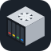
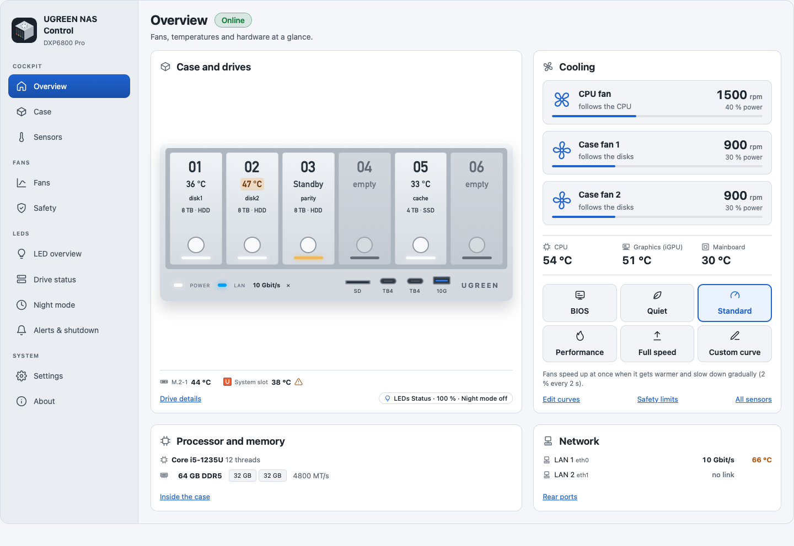

<div align="center">



# Unraid on UGREEN. Done right.

**Fans. LEDs. Live case view. Sensors. One plugin. No kernel module.**

Your UGREEN NAS is not a generic box. It deserves more than generic defaults.<br>
This plugin is the bridge.

**Keep the hardware watchdog on. Leave it armed in the BIOS, the plugin feeds it, and a frozen box reboots itself** (DXP4800 GT, iDX6011 Pro).

[](https://github.com/alexanderschubert/ugreen-nas-control/releases/latest)
[](LICENSE)
[](docs/unraid.md)

**[Live demo](https://alexanderschubert.github.io/ugreen-nas-control/demo/?model=dxp6800-pro)** · [Install](#install-in-60-seconds) · [Models](#your-model-your-status) · [Docs](#documentation) · [Help](#help)

<a href="https://alexanderschubert.github.io/ugreen-nas-control/demo/?model=dxp6800-pro"><picture><source media="(prefers-color-scheme: dark)" srcset="docs/ca/overview-dark.png"></picture></a>

<sub>The real plugin UI, rendered by CI. No mockups. <a href="https://alexanderschubert.github.io/ugreen-nas-control/demo/?model=dxp6800-pro">Click through it in your browser.</a></sub>

</div>

## Install in 60 seconds

**Runs on every UGREEN NAS that runs Unraid: the x86 DX, DXP and iDX series** (Unraid 7.2+). The ARM-based DH models can't run Unraid.

1. Unraid: **Plugins, Install Plugin**
2. Paste this URL, hit **Install**:

```
https://raw.githubusercontent.com/alexanderschubert/ugreen-nas-control/main/plugin/ugreen-nas-control.plg
```

3. Open **Settings, UGREEN NAS Control**. It names the model it found.

Try the next build (latest head of `next`, not for production): install `https://github.com/alexanderschubert/ugreen-nas-control/releases/download/next-build/ugreen-nas-control.plg`. It replaces a stable install in place and keeps your settings; to go back, run `plugin install <stable plg URL> forced`. See [docs/releasing.md](docs/releasing.md).

## What you get

- **Case view.** Your box, drawn as it is: bays with drive temperatures and LED colours, rear ports with LAN link speeds, and the inside (M.2, RAM, PCIe) where mapped. Dark and light.
- **Hardware watchdog, kept on.** Under Unraid nothing feeds UGREEN's watchdog, so the box resets every few minutes and you switch it off in the BIOS. Leave it on instead (DXP4800 GT, iDX6011 Pro): the plugin feeds it, and a frozen box reboots itself. It never arms the watchdog, and on stop it clears it.
- **Fan curves in rpm.** Quiet, Standard, Performance, Full speed or your own curve. "Measure fans" records real rpm per speed. Too hot? All fans go to 100 %. Plugin stops? BIOS values come back.
- **LEDs that say something.** Colour, effects and brightness per LED. Disk activity, errors, SMART warnings, network speed, night mode. Off until you switch them on.
- **Sensors, dashboard tile, MQTT.** CPU, board, iGPU, NVMe and disks, each marked with the fan it steers. Sleeping disks stay asleep. Publish status to Home Assistant, read-only.
- **7 languages.** English, German, Spanish, French, Italian, Dutch, Chinese.

## Your model. Your status.

Every model, every claim, on the record. Each cell is dated and links to its evidence on the model page. Not green? Bring your model: the probe wizard maps unknown fan wiring in about a minute, and **About, Confirm my device** files the report for you.

<!-- models:start -->
<!-- Generated by docs/tools/gen-docs.ts from web/models/. Do not edit; run `just docs`. -->

**2 verified, 7 community-tested, 5 expected.**

● verified · ◔ community-tested · ◐ partly confirmed · ○ expected · – not offered

**DX series**

| Model                                                                                   | LEDs | Fan control | Case view | Sensors | Status             |
| --------------------------------------------------------------------------------------- | ---- | ----------- | --------- | ------- | ------------------ |
| [DX4600 Pro](https://alexanderschubert.github.io/ugreen-nas-control/models/dx4600-pro/) | ◔    | –           | –         | ○       | ◔ Community-tested |
| [DX4700+](https://alexanderschubert.github.io/ugreen-nas-control/models/dx4700/)        | ◔    | –           | –         | ○       | ◔ Community-tested |

**DXP series**

| Model                                                                                         | LEDs | Fan control | Case view | Sensors | Status             |
| --------------------------------------------------------------------------------------------- | ---- | ----------- | --------- | ------- | ------------------ |
| [DXP4800 GT](https://alexanderschubert.github.io/ugreen-nas-control/models/dxp4800-gt/)       | ●    | ●           | ●         | ●       | ● Verified         |
| [DXP6800 Pro](https://alexanderschubert.github.io/ugreen-nas-control/models/dxp6800-pro/)     | ●    | ●           | ●         | ●       | ● Verified         |
| [DXP480T Plus](https://alexanderschubert.github.io/ugreen-nas-control/models/dxp480t-plus/)   | ◐    | –           | –         | ○       | ◔ Community-tested |
| [DXP2800](https://alexanderschubert.github.io/ugreen-nas-control/models/dxp2800/)             | ◔    | ○           | ○         | ○       | ◔ Community-tested |
| [DXP4800](https://alexanderschubert.github.io/ugreen-nas-control/models/dxp4800-base/)        | ◔    | ○           | ○         | ○       | ◔ Community-tested |
| [DXP4800 Plus / Pro](https://alexanderschubert.github.io/ugreen-nas-control/models/dxp4800/)  | ◔    | ○           | ○         | ○       | ◔ Community-tested |
| [DXP8800 Plus](https://alexanderschubert.github.io/ugreen-nas-control/models/dxp8800-plus/)   | ◔    | ○           | ○         | ○       | ◔ Community-tested |
| [DXP2800 GT](https://alexanderschubert.github.io/ugreen-nas-control/models/dxp2800-gt/)       | ○    | –           | ○         | ○       | ○ Expected         |
| [DXP4800S](https://alexanderschubert.github.io/ugreen-nas-control/models/dxp4800s/)           | ○    | –           | –         | ○       | ○ Expected         |
| [DXP6800 Ultra](https://alexanderschubert.github.io/ugreen-nas-control/models/dxp6800-ultra/) | ○    | –           | –         | ○       | ○ Expected         |
| [DXP8800 Ultra](https://alexanderschubert.github.io/ugreen-nas-control/models/dxp8800-ultra/) | ○    | –           | –         | ○       | ○ Expected         |

**iDX series**

| Model                                                                                             | LEDs | Fan control | Case view | Sensors | Status     |
| ------------------------------------------------------------------------------------------------- | ---- | ----------- | --------- | ------- | ---------- |
| [iDX6011 / iDX6012 / Pro](https://alexanderschubert.github.io/ugreen-nas-control/models/idx6011/) | ○    | ○           | ○         | ○       | ○ Expected |

Versions, dates and evidence per cell: [docs/hardware.md](docs/hardware.md), or the model page on the website.

<!-- models:end -->

Model missing or marked Expected? Run `ugreen-nas-ctl report` and paste the output into the [model report form](https://github.com/alexanderschubert/ugreen-nas-control/issues/new?template=model-report.yml).

## Help

[Unraid forum thread](https://forums.unraid.net/topic/201044-plugin-ugreen-nas-control-led-fan-and-system-control-for-ugreen-dxdxp-nas/) · [GitHub issues](https://github.com/alexanderschubert/ugreen-nas-control/issues/new/choose) · [FAQ](docs/faq.md)

## Documentation

[FAQ](docs/faq.md) · [Hardware](docs/hardware.md) · [MQTT](docs/mqtt.md) · [Unraid compatibility](docs/unraid.md) · [Changelog](CHANGELOG.md)

<details>
<summary>All documents</summary>

<!-- docs:start -->
<!-- Generated by docs/tools/gen-docs.ts from web/models/. Do not edit; run `just docs`. -->

| Document                                                                                    | Purpose                                        |
| ------------------------------------------------------------------------------------------- | ---------------------------------------------- |
| [Hardware](docs/hardware.md)                                                                | Model details, evidence, adding models         |
| [FAQ](docs/faq.md)                                                                          | Features, command line, disclaimer             |
| [MQTT](docs/mqtt.md)                                                                        | MQTT publisher for displays and Home Assistant |
| [Architecture](docs/architecture.md)                                                        | How the plugin is built                        |
| [Development](docs/development.md)                                                          | Setup, recipes, tests, conventions             |
| [Releasing](docs/releasing.md)                                                              | Release and next channels                      |
| [Translations](docs/translations.md)                                                        | Languages and how to translate                 |
| [Unraid compatibility](docs/unraid.md)                                                      | Unraid versions and compatibility              |
| [Related projects](docs/competition.md)                                                     | Related projects compared                      |
| [Declined](docs/decisions.md)                                                               | Declined ideas and why                         |
| [Third-party notices](docs/third-party.md)                                                  | Sources, licenses, notices                     |
| [Contributing](.github/CONTRIBUTING.md)                                                     | How to send changes                            |
| [Security](.github/SECURITY.md)                                                             | Reporting vulnerabilities                      |
| [Changelog](CHANGELOG.md)                                                                   | Changes per release                            |
| [plugin/](plugin/README.md)                                                                 | Plugin package layout                          |
| [Website](https://alexanderschubert.github.io/ugreen-nas-control/)                          | Models and guides                              |
| [Live demo](https://alexanderschubert.github.io/ugreen-nas-control/demo/?model=dxp6800-pro) | Try the interface in a browser                 |

<!-- docs:end -->

</details>

## Credits

Maintainer: [Alexander Schubert](https://github.com/alexanderschubert). Contributor: [j3n57h0m45](https://github.com/j3n57h0m45) (DXP4800 GT support, UX overhaul, fan measuring, CI).
Built on the work of [miskcoo](https://github.com/miskcoo/ugreen_leds_controller) and others: full list and licenses in [docs/third-party.md](docs/third-party.md).

## License

[MIT](LICENSE). UGREEN and Unraid are trademarks of their owners; this project is not affiliated with either. Use at your own risk, see the [disclaimer](docs/faq.md#disclaimer).
