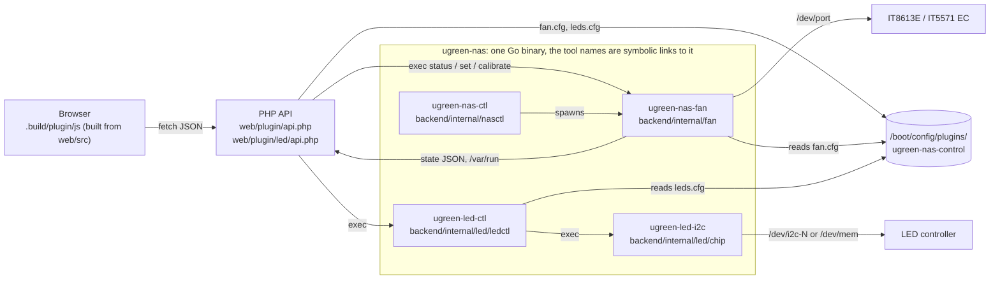

# Architecture

Nothing runs in the kernel; everything is a normal process or a PHP request. All the Go code is one binary, `ugreen-nas`, that runs as the tool its name says (multicall); the archive holds it once and the four tool names as symbolic links.



## Components

| Part                | Path                                               | Language                    | Job                                                                                                                                                                                                                                   |
| ------------------- | -------------------------------------------------- | --------------------------- | ------------------------------------------------------------------------------------------------------------------------------------------------------------------------------------------------------------------------------------- |
| One binary          | `backend/cmd/ugreen-nas`                           | Go, static, no dependencies | `ugreen-nas` dispatches on the name it was started as (or on its first argument: `ugreen-nas led-ctl status`) to the four tools below. `plugin/files.txt` installs the names as symbolic links.                                       |
| Fan tool and daemon | `backend/internal/fan` (`ugreen-nas-fan`)          | Go                          | Talks to the fan chip, runs the curves every 2 s, reads sensors, measures fans, restores BIOS values; also the MQTT publisher (`backend/internal/mqtt`). [fan.md](fan.md), [cli.md](cli.md#ugreen-nas-fan)                            |
| Daemon control      | `backend/internal/nasctl` (`ugreen-nas-ctl`)       | Go                          | Starts and stops the fan daemon and the MQTT publisher, the LED switch, `report`, the shutdown event. [cli.md](cli.md#ugreen-nas-ctl)                                                                                                 |
| LED tool            | `backend/internal/led/chip` (`ugreen-led-i2c`)     | Go                          | Writes LED colour, brightness and effects to the LED controller. [led.md](led.md)                                                                                                                                                     |
| LED backend         | `backend/internal/led/ledctl` (`ugreen-led-ctl`)   | Go                          | Decides what each LED shows and calls the LED tool. [led.md](led.md), [SPEC.md](../backend/internal/led/ledctl/SPEC.md)                                                                                                               |
| Web                 | `web/plugin/` (`led/` inside it for the LED pages) | PHP, CSS, built JS          | Settings page (`UGREENNASControl.page`), dashboard tile (`UGREENNASDashboard.page`), the JSON APIs `api.php`.                                                                                                                         |
| Frontend source     | `web/src/` (`core/`, `features/`, `dash/`)         | TypeScript                  | Bundled by `web/tools/build.ts` into the plain scripts under `.build/plugin/js` and `.build/plugin/led/js` (the install tree). Those are not tracked; edit `web/src`.                                                                 |
| Shared Go code      | `backend/internal/{hw,fsx,proc,testenv}`           | Go                          | I/O ports (`/dev/port`) and the DMI model name (`hw`); atomic state-file writes that never follow a symbolic link (`fsx`); "is this pid one of ours" for pidfiles (`proc`); the gate for test-only environment variables (`testenv`). |
| Package             | `plugin/`                                          | template                    | `ugreen-nas-control.plg` is rendered from `ugreen-nas-control.plg.tmpl` and `plugin/files.txt`; `plugin/tools/plg.ts pack` builds the one archive the `.plg` downloads.                                                               |

## How they talk

- The browser polls `api.php` (JSON). `GET ?action=status` runs `ugreen-nas-fan status`, which prints sensors, chip state, presets and the daemon's state file (`/var/run/ugreen-nas-control.json`). POST actions (mode, curves, safety, language, theme, LED switch) are CSRF-checked by Unraid and write `fan.cfg`; the daemon re-reads it.
- The LED API (`web/plugin/led/api.php`) calls `ugreen-led-ctl`, which calls `ugreen-led-i2c` ([led.md](led.md)).
- `event/stopping` (source `plugin/event/stopping`) is an Unraid event script, the only shell file the plugin ships besides the inline install and remove scripts of the `.plg`. It runs `ugreen-nas-ctl event stopping` ([led.md](led.md#led-tool-and-backend)).
- Config lives in `/boot/config/plugins/ugreen-nas-control/` (`fan.cfg`, `leds.cfg`, `fan_rpm.json`, `led.enabled`) and survives removal. Runtime files live in `/var/run`.
- Every path and tool can be overridden with `UGREEN_*` environment variables, but only in a binary built with `-tags testhooks` (the tests, the harness). The release build compiles `testenv.Get` to an empty string, so the environment of a root process (cron, php-fpm) cannot redirect the tools. Gated: every `UGREEN_*` variable of the Go code (`UGREEN_PRODUCT`, `UGREEN_LAYOUT`, `UGREEN_NOW`, `UGREEN_LED_CHIP`, `UGREEN_LED_I2C`, `UGREEN_NAS_FAN`, `UGREEN_LED_CTL`, `UGREEN_LED_DIR`, `UGREEN_LED_FLAG`, `UGREEN_LED_CRON`, `UGREEN_LED_CFG`, `UGREEN_LED_CONFIG`, `UGREEN_LED_IMPORT_SRC`, `UGREEN_LED_LEGACY_PIDS`, `UGREEN_UPDATE_CRON`, `UGREEN_DMI`, `UGREEN_DMI_PRODUCT`, `UGREEN_DMIDECODE`, `UGREEN_ETHTOOL`, `UGREEN_SYS`, `UGREEN_SYS_*`, `UGREEN_HWMON`, `UGREEN_MOUNTS`, `UGREEN_HW_CACHE`, `UGREEN_ACPI_DEVICES`, `UGREEN_DISKS_INI`, `UGREEN_VAR_INI`, `UGREEN_SMART_DIR`, `UGREEN_UDEV_DATA`, `UGREEN_DYNAMIX_CFG`, `UGREEN_NOTIFY_DIR`, `UGREEN_OSRELEASE`, `UGREEN_PROC*`, `UGREEN_PLUGINS_*`, `UGREEN_UNRAID_VERSION`, `UGREEN_FAN_*`, `UGREEN_*PIDFILE`, `UGREEN_*_MARK`, `UGREEN_*_PREFIX`, `UGREEN_*_STATE`, `UGREEN_*_CACHE`, `UGREEN_FX_LOG`).
- Pidfiles are trusted only for a process that is ours (`internal/proc`: the executable or the command line is a tool of the plugin); a stale file whose pid was reused is never signalled. State files in `/var/run` and `/boot/config` are written to a temporary name and renamed (`internal/fsx`), and a symbolic link in their place is replaced, never followed.
- Settings are checked in Go before they reach the LED tool or the chip: colours are `R G B` with 0 to 255, durations digits up to 65535, effect names and speeds come from fixed lists, fan settings keep their range; a value that does not fit is logged once and replaced by its default.
- The fan tool and the LED tool take a lock (`/var/run/ugreen-nas-control.lock`, and an I2C bus lock shared with the standalone UGREEN LED Control plugin) so two writers never talk to the hardware at once.

## Where to add things

- A model: add `web/models/<id>.ts` ([development.md](development.md#add-a-model)); the plugin's own model table still lives in the frontend source under `web/src/features/nas`.
- A page or sensor: `web/src/features/nas/`; texts in every language ([translations.md](translations.md)).
- A shipped file: add it to `plugin/files.txt`; `just plg-check` fails otherwise.

## Repository layout

```
backend/             the Go module (go.mod)
  cmd/ugreen-nas/      the one multicall binary (fan, led-i2c, led-ctl, nas-ctl)
  internal/hw/         shared hardware access (I/O ports, DMI)
  internal/fan/        fan chip, curves, daemon, sensors
  internal/led/        chip (SMBus protocol, effects), ledctl (LED CLI and daemon), parity (the Go tools against the goldens recorded from the former shell scripts)
  internal/mqtt/       MQTT publisher (ugreen-nas-fan publish)
  internal/nasctl/     ugreen-nas-ctl: fan daemon control, LED switch, report
  internal/{fsx,proc,testenv}/  atomic file writes, pid ownership, gate for test variables
web/                 the browser side and its tooling (bun)
  src/                 TypeScript: core/ (shared), features/{nas,led}/, dash/, testing/
  plugin/              what installs under /usr/local/emhttp/plugins/ugreen-nas-control (same relative paths); js/ and the PNGs are built
  models/              the model registry; assets/ icon sources; tools/ build, lint, harness, screenshots, e2e
plugin/              release packaging: .plg template, files.txt (the shipped files), event/stopping (the Unraid event hook), generated plugin/ugreen-nas-control.plg, tools/ (plg, changes, release)
plugins/             the Community Applications template (ugreen-nas-control.xml); ca_profile.xml at the root
docs/                these documents, site/ (the Pages builder) and tools/ (docs generator)
scripts/             repo-wide checks: generated files, formatter wrapper
.changes/            changelog fragments (one per PR)
.build/              all build output (gitignored): bin/, dist/, site/, shots/
```

One Go module (`backend/go.mod`). Generated files are never tracked, with five documented exceptions (`.gitattributes`); `scripts/generated.ts` lists what the generators write.

## Adding a feature

A feature is one hardware function with its own page or tile (fans, LEDs, a new sensor family).

1. Hardware access: a package `backend/internal/<feature>/` (logic, with a fake for `hw.Ports` or the file system in the tests) and, for a new tool name, a case in `backend/cmd/ugreen-nas` that only calls into it. Put code the fan and LED parts both need in `backend/internal/hw`.
2. Backend: a subcommand of the multicall binary (`backend/cmd/ugreen-nas`, add the name to `tools`), started from `ugreen-nas-ctl` (`backend/internal/nasctl`) when it is a daemon. No new shell scripts: Unraid forces only the inline scripts of the `.plg` and the event hooks.
3. API: an action in `web/plugin/api.php` (or a `web/plugin/<feature>/api.php` of its own) that calls the tool and returns JSON; extend `web/src/core/contract.ts` and `guard.ts` with its shape.
4. Frontend: `web/src/features/<feature>/` with `app.ts`, `text.ts` and `i18n/<code>.ts` for every language ([translations.md](translations.md)); shared helpers go to `web/src/core/`. Register the entry point in `WEB_BUNDLES` in `scripts/generated.ts` (the output path is under `.build/plugin/js`, gitignored) and add a `<script>` for it to the page.
5. Shipping: add every new source (and the bundle's output path) to `plugin/files.txt`; `just plg-check` lists what is missing. The binary is `release:ugreen-nas` (built to `.build/bin/ugreen-nas` by `just go-build`); a tool name is a line `release:<name> <path> -> <target>` (a symbolic link to it).
6. Models: a capability flag in `web/models/schema.ts` (like `fan`) says which models have the feature; fill it in the model files, `web/models/fixture.ts` for the harness data, then `just docs`. The plugin decides at run time from the DMI name (`MODELS` in `web/src/features/nas/app.ts`, `layoutFor` in `backend/internal/fan/hardware.go`).
7. Checks: tests next to the code, i18n keys in every language, `just check`, then `just harness <model>` and `just e2e`.
