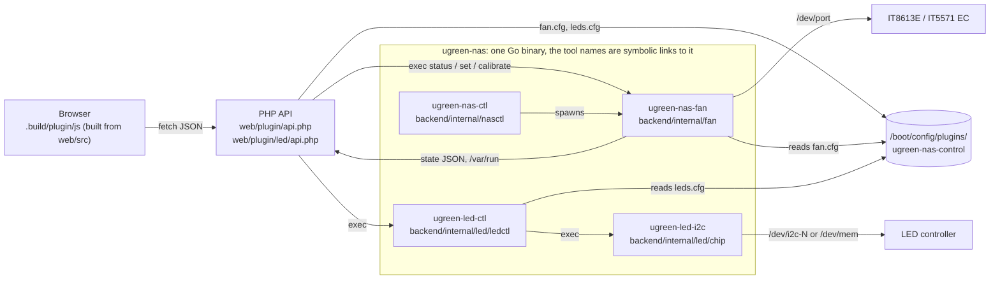

# Architecture

The plugin has five parts. Nothing runs in the kernel; everything is a normal process or a PHP request. All the Go code is one binary, `ugreen-nas`, that runs as the tool its name says (multicall); the archive holds it once and the four tool names as symbolic links.



## Components

| Part                | Path                                               | Language                    | Job                                                                                                                                                                                                                                                                                                                                        |
| ------------------- | -------------------------------------------------- | --------------------------- | ------------------------------------------------------------------------------------------------------------------------------------------------------------------------------------------------------------------------------------------------------------------------------------------------------------------------------------------ |
| One binary          | `backend/cmd/ugreen-nas`                           | Go, static, no dependencies | `ugreen-nas` dispatches on the name it was started as (or on its first argument: `ugreen-nas led-ctl status`) to the four tools below. `plugin/files.txt` installs the names as symbolic links.                                                                                                                                            |
| Fan tool and daemon | `backend/internal/fan` (`ugreen-nas-fan`)          | Go                          | Talks to the fan chip, runs the curves every 2 s, reads sensors, measures fans (`calibrate`), restores BIOS values. Subcommands: `info`, `hardware`, `conflicts`, `cs201x`, `probe`, `probe-fans`, `backlight`, `status`, `history`, `set`, `calibrate`, `restore`, `daemon`, and `publish` (the MQTT publisher, `backend/internal/mqtt`). |
| Daemon control      | `backend/internal/nasctl` (`ugreen-nas-ctl`)       | Go                          | `start`, `stop`, `restart`, `status` of the fan daemon (pid file, error log); `mqtt-start`, `mqtt-stop`, `mqtt-status` for the MQTT publisher; the LED switch (`led-status`, `led-enable`, `led-disable`, `led-import`, `led-boot`, `led-stop`); `report` (anonymised JSON for a model report); `event stopping`.                          |
| LED tool            | `backend/internal/led/chip` (`ugreen-led-i2c`)     | Go                          | Writes LED colour, brightness and effects to the LED controller over SMBus (`/dev/i2c-N`) or, on the DXP4800 GT, through `/dev/mem`.                                                                                                                                                                                                       |
| LED backend         | `backend/internal/led/ledctl` (`ugreen-led-ctl`)   | Go                          | Decides what each LED shows: status mode from `disks.ini`, SMART and link speed, night mode, alerts, shutdown signal, effects. Calls the LED tool. [SPEC.md](../backend/internal/led/ledctl/SPEC.md) lists the behaviour.                                                                                                                  |
| Web                 | `web/plugin/` (`led/` inside it for the LED pages) | PHP, CSS, built JS          | Settings page (`UGREENNASControl.page`), dashboard tile (`UGREENNASDashboard.page`), the JSON APIs `api.php`.                                                                                                                                                                                                                              |
| Frontend source     | `web/src/` (`core/`, `features/`, `dash/`)         | TypeScript                  | Bundled by `web/tools/build.ts` into the plain scripts under `.build/plugin/js` and `.build/plugin/led/js` (the install tree). Those are not tracked; edit `web/src`.                                                                                                                                                                      |
| Shared Go code      | `backend/internal/{hw,fsx,proc,testenv}`           | Go                          | I/O ports (`/dev/port`) and the DMI model name (`hw`); atomic state-file writes that never follow a symbolic link (`fsx`); "is this pid one of ours" for pidfiles (`proc`); the gate for test-only environment variables (`testenv`).                                                                                                      |
| Package             | `plugin/`                                          | template                    | `ugreen-nas-control.plg` is rendered from `ugreen-nas-control.plg.tmpl` and `plugin/files.txt`; `plugin/tools/plg.ts pack` builds the one archive the `.plg` downloads.                                                                                                                                                                    |

## How they talk

- The browser polls `api.php` (JSON). `GET ?action=status` runs `ugreen-nas-fan status`, which prints sensors, chip state, presets and the daemon's state file (`/var/run/ugreen-nas-control.json`). POST actions (mode, curves, safety, language, theme, LED switch) are CSRF-checked by Unraid and write `fan.cfg`; the daemon re-reads it.
- The LED API (`web/plugin/led/api.php`) calls `ugreen-led-ctl`, which keeps its runtime state in `/var/run/ugreen-nas-control.led*` and calls `ugreen-led-i2c`.
- `event/stopping` (source `plugin/event/stopping`) is an Unraid event script, the only shell file the plugin ships besides the inline install and remove scripts of the `.plg`. It runs `ugreen-nas-ctl event stopping`, which tells the LED backend about shutdown so the power LED can signal it.
- Config lives in `/boot/config/plugins/ugreen-nas-control/` (`fan.cfg`, `leds.cfg`, `fan_rpm.json`, `led.enabled`) and survives removal. Runtime files live in `/var/run`.
- Every path and tool can be overridden with `UGREEN_*` environment variables, but only in a binary built with `-tags testhooks` (the tests, the harness). The release build compiles `testenv.Get` to an empty string, so the environment of a root process (cron, php-fpm) cannot redirect the tools. Gated: every `UGREEN_*` variable of the Go code (`UGREEN_PRODUCT`, `UGREEN_LAYOUT`, `UGREEN_NOW`, `UGREEN_LED_CHIP`, `UGREEN_LED_I2C`, `UGREEN_NAS_FAN`, `UGREEN_LED_CTL`, `UGREEN_LED_DIR`, `UGREEN_LED_FLAG`, `UGREEN_LED_CRON`, `UGREEN_LED_CFG`, `UGREEN_LED_CONFIG`, `UGREEN_LED_IMPORT_SRC`, `UGREEN_LED_LEGACY_PIDS`, `UGREEN_UPDATE_CRON`, `UGREEN_DMI`, `UGREEN_DMI_PRODUCT`, `UGREEN_DMIDECODE`, `UGREEN_ETHTOOL`, `UGREEN_SYS`, `UGREEN_SYS_*`, `UGREEN_HWMON`, `UGREEN_MOUNTS`, `UGREEN_HW_CACHE`, `UGREEN_ACPI_DEVICES`, `UGREEN_DISKS_INI`, `UGREEN_VAR_INI`, `UGREEN_SMART_DIR`, `UGREEN_UDEV_DATA`, `UGREEN_DYNAMIX_CFG`, `UGREEN_NOTIFY_DIR`, `UGREEN_OSRELEASE`, `UGREEN_PROC*`, `UGREEN_PLUGINS_*`, `UGREEN_UNRAID_VERSION`, `UGREEN_FAN_*`, `UGREEN_*PIDFILE`, `UGREEN_*_MARK`, `UGREEN_*_PREFIX`, `UGREEN_*_STATE`, `UGREEN_*_CACHE`, `UGREEN_FX_LOG`).
- Pidfiles are trusted only for a process that is ours (`internal/proc`: the executable or the command line is a tool of the plugin); a stale file whose pid was reused is never signalled. State files in `/var/run` and `/boot/config` are written to a temporary name and renamed (`internal/fsx`), and a symbolic link in their place is replaced, never followed.
- Settings are checked in Go before they reach the LED tool or the chip: colours are `R G B` with 0 to 255, durations digits up to 65535, effect names and speeds come from fixed lists, fan settings keep their range; a value that does not fit is logged once and replaced by its default.
- The fan tool and the LED tool take a lock (`/var/run/ugreen-nas-control.lock`, and an I2C bus lock shared with the standalone UGREEN LED Control plugin) so two writers never talk to the hardware at once.

## Fan hardware

Unraid's kernel has no driver for these chips, so `ugreen-nas-fan` talks to them through `/dev/port`, the way `sensors-detect` finds them.

**DXP6800 Pro, ITE IT8613E**

- Super-I/O config ports `0x2e`/`0x2f` give the chip id (`0x8613`) and the base address of the environment controller (`0x0a30`).
- Fan speed comes from the tachometer counters: rpm = 1 350 000 / (2 x count).
- The BIOS leaves the PWM outputs in manual mode with a fixed duty cycle. The daemon changes it every 2 seconds following the curves.
- CPU fan on header 2, case fans on headers 3 and 4.

**DXP4800 GT, ITE IT5571 embedded controller**

- Reached through the ACPI EC ports `0x62` (data) and `0x66` (command/status), under the same lock, with bounded waits and retries.
- CPU fan (fan1): mode register `0xb0`, duty `0xb1`, tachometer `0x34`/`0x35`. Case fan (fan3): `0xb4`, `0xb5`, `0x38`/`0x39`.
- Duty runs 0 to 198; the tachometer counter is the rpm. Mode 0 is the controller's own curve, 1 is manual.
- CPU temperature comes from the AMD sensor (`k10temp`), mainboard temperature from the controller.

**Fan settings and pipeline order**

- `fan.cfg` is v1 (no `cfg_version`) or v2 (`cfg_version="2"`). A v1 file loads with groups that repeat today's globals (the group curve, `min_run` = `min_pct`, `up_step` 100 = at once, `down_step` 2, no deadband, no kick-start, quiet hours and jobs off), so it decides exactly as before; v2 keys in a v1 file are ignored. The daemon never rewrites it. The first v2 save from the web page copies the file to `fan.cfg.bak` (once) and adds `cfg_version="2"`.
- v2 keys: per group `cpu_`/`case_` + `input`, `deadband`, `start_pct`, `start_ms`, `min_run`, `up_step`, `down_step`, `on_missing` (`fallback`, `curve_low`, `hold`); the group curves stay `cpu_curve`/`case_curve`. A fan can override any of them, and the curve, as `fan.<id>.<key>` (`fan.fan3.deadband`). Quiet hours: `quiet_enabled`, `quiet_from`, `quiet_to` (HH:MM, may cross midnight), `quiet_days` (`mon,tue,...`), `quiet_cap`, `quiet_scope` (`case`, `all`). Jobs: `job_mover`, `job_parity` (`off`, `floor`, `boost`) with `job_mover_pct`, `job_parity_pct`. Invalid values warn and keep the default (`ValidateSetting` in `config_v2.go`; `web/plugin/include/fan_v2.php` checks the same table before `api.php` saves).
- Input specs: `auto` (default: the CPU for `cpu`; the hottest non-ignored disk, or NVMe minus `nvme_offset`, for `case`), `cpu`, `disk_max[:disk1+disk2]`, `disk_avg[:disk1+disk2]`, `nvme`, `gpu`, `nic:<iface>`, `script:<name>`, `max:<spec>|<spec>` (2 to 8, no nesting).
- Order per tick: inputs, curve, shape (deadband, kick-start, minimum run speed, ramps), job floor or boost, quiet cap, emergency override. The emergency check runs first and its 100 % is never capped, ramped, held by a deadband or scheduled. A missing input follows `on_missing` and never leaves a group silently off; an unreadable CPU still raises `cpu_unreadable`. Script, GPU and NIC temperatures never trigger the disk emergency. The quiet cap never goes below `min_run`. Calibration pauses all of it.

**Safety logic**

- The first start after boot saves the BIOS values to `/var/run/ugreen-nas-control.bios`. Stopping the daemon (also on update or removal) and `restore` write them back.
- All fans go to 100 % when the CPU or a disk reaches its limit, when the CPU temperature cannot be read, and when the hottest non-ignored NVMe minus the NVMe offset reaches the disk limit.
- With fan control switched off in Settings the tool makes no read or write on the fan chip.
- On any model not in `web/models/` with a `fan` entry, the plugin does not touch the fan controller.

**Fan history**

- The daemon records every tick (2 s) into two rings in its own RAM (`backend/internal/fan/history.go`): 10 s steps for the last hour (360 points) and 60 s averages for the last 24 hours (1440 points). A point holds the CPU and hottest-drive temperature and, per fan (at most 6), speed, rpm, the driving input, its temperature and the modifiers: 56 bytes, about 100 KB in total, allocated once. Nothing is written to disk; a daemon restart starts it again.
- What drove a fan comes from the pipeline itself (`drive.go`, filled in `shape_pipeline.go`): the source (`cpu`, `disk:<name>` for the hottest drive, `disk_avg`, `nvme`, `gpu`, `nic:<iface>`, `script:<name>`, `idle`, `missing`, `hold`, `emergency:<reason>`; `bios`, `calibration`, `rival` while the daemon does not drive) and modifier bits (quiet cap, mover, parity, minimum speed, ramp, emergency, input missing). An emergency is never averaged away.
- Reading: `ugreen-nas-fan history [1h|24h]` asks the daemon over the unix socket `/var/run/ugreen-nas-control.history.sock` (root only; `UGREEN_FAN_HISTORY` in test builds) and prints one JSON object of arrays (`web/src/core/contract-fan-history.ts`). `api.php?action=fan_history&range=1h|24h` calls it. The socket costs nothing while nobody asks; the History page asks only while it is on screen.

## LED hardware

All DX, DXP and iDX models share the same LED controller protocol, after [miskcoo/ugreen_leds_controller](https://github.com/miskcoo/ugreen_leds_controller). Bays map to LEDs by SATA port. The LED part is offered when the DMI product name starts with `DX`, `DXP` or `iDX`, and not while the plugin _ugreenleds-driver_ or the kernel module `led_ugreen` holds the controller. If the standalone UGREEN LED Control plugin is installed too, both write the same LEDs and the last write wins.

## Rival fan and LED tools

`backend/internal/fan/conflict` finds other tools that can write the same chips; read only, every path injectable (`UGREEN_PLUGINS_BOOT`, `UGREEN_PROC_MODULES`, `UGREEN_SYS_MODULE`, `UGREEN_SYS_HWMON`, `UGREEN_PROC`). `ugreen-nas-fan conflicts` prints the list; `status` carries it as `conflicts[]` plus `conflict`.

| Kind     | Source                                                                                                                                      | Severity |
| -------- | ------------------------------------------------------------------------------------------------------------------------------------------- | -------- |
| `daemon` | `/proc/*/cmdline`: FanCtrl Plus (2) loop, `autofan`, `ugreen-fan-control`, `ugreen-gt-leds`, `ugreen-pro-leds`, `ugreen-leds`, `panel_dash` | block    |
| `plugin` | `/boot/config/plugins/<name>.plg` or `/usr/local/emhttp/plugins/<name>/` of the known rival plugins                                         | warn     |
| `module` | `it87`, `led_ugreen` in `/proc/modules` or `/sys/module`                                                                                    | warn     |
| `hwmon`  | `it8613`/`it5571` device with `pwmN_enable` = 1 (manual)                                                                                    | warn     |

- **Fans:** a `block` finding makes the daemon read only: no `SetPWM`, no BIOS restore at stop, `set` and `calibrate` refuse. Temperatures, rpm and `daemon.conflict` stay current. When the rival ends, the curves resume on the next tick.
- **Emergency:** the daemon does not answer an emergency with 100 % while a rival runs, since that would overwrite the rival every 2 s. It logs it, sends one Unraid alert per episode and sets `daemon.unapplied`; the web page shows the reason in the banner. Only a running writer counts: an installed plugin, a loaded `it87` or manual pwm mode (the BIOS leaves it too) is shown and never makes the daemon yield.
- **LEDs:** `api.php` sets `led.blocker = rival` while a rival LED tool runs and ours is off. A running LED part is not stopped by itself; the banner offers to switch it off. `ugreen-nas-ctl` (switch on, boot) and the LED status daemon (at start and every 30 s) call the detector: a rival LED plugin or a running rival LED process blocks the switch, and the daemon exits and leaves the LEDs to it.
- **Web:** a banner on every page per running rival with "Use UGREEN NAS Control" (link to the Plugins page; other plugins are never removed from here) and "Keep <rival>, turn off our fan/LED control" (the existing switches). Settings lists every finding. Harness: `UNC_SCENARIO=conflict` (or `conflict-led`) for `web/tools/harness/serve.ts` and `shots.ts`.

## Where to add things

- A model: add `web/models/<id>.ts` ([development.md](development.md)); the plugin's own model table still lives in the frontend source under `web/src/features/nas`.
- A page or sensor: `web/src/features/nas/`; texts in every language ([translations.md](translations.md)).
- A shipped file: add it to `plugin/files.txt`; `just plg-check` fails otherwise.

## Repository layout

```
backend/             the Go module (go.mod)
  cmd/ugreen-nas/      the one multicall binary (fan, led-i2c, led-ctl, nas-ctl)
  internal/hw/         shared hardware access (I/O ports, DMI)
  internal/fan/        fan chip, curves, daemon, sensors
  internal/led/        chip (SMBus protocol, effects), ledctl (LED CLI and daemon), parity (the Go tools against the goldens recorded from the former shell scripts)
  internal/mqtt/       MQTT publisher (ugreen-nas-fan publish)
  internal/nasctl/     ugreen-nas-ctl: fan daemon control, LED switch, report
  internal/{fsx,proc,testenv}/  atomic file writes, pid ownership, gate for test variables
web/                 the browser side and its tooling (bun)
  src/                 TypeScript: core/ (shared), features/{nas,led}/, dash/, testing/
  plugin/              what installs under /usr/local/emhttp/plugins/ugreen-nas-control (same relative paths); js/ and the PNGs are built
  models/              the model registry; assets/ icon sources; tools/ build, lint, harness, screenshots, e2e
plugin/              release packaging: .plg template, files.txt (the shipped files), event/stopping (the Unraid event hook), generated plugin/ugreen-nas-control.plg, tools/ (plg, changes, release)
plugins/             the Community Applications template (ugreen-nas-control.xml); ca_profile.xml at the root
docs/                these documents, site/ (the Pages builder) and tools/ (docs generator)
scripts/             repo-wide checks: generated files, formatter wrapper
.changes/            changelog fragments (one per PR)
.build/              all build output (gitignored): bin/, dist/, site/, shots/
```

One Go module (`backend/go.mod`). Generated files are never tracked, with five documented exceptions (`.gitattributes`); `scripts/generated.ts` lists what the generators write.

## Adding a feature

A feature is one hardware function with its own page or tile (fans, LEDs, a new sensor family).

1. Hardware access: a package `backend/internal/<feature>/` (logic, with a fake for `hw.Ports` or the file system in the tests) and, for a new tool name, a case in `backend/cmd/ugreen-nas` that only calls into it. Put code the fan and LED parts both need in `backend/internal/hw`.
2. Backend: a subcommand of the multicall binary (`backend/cmd/ugreen-nas`, add the name to `tools`), started from `ugreen-nas-ctl` (`backend/internal/nasctl`) when it is a daemon. No new shell scripts: Unraid forces only the inline scripts of the `.plg` and the event hooks.
3. API: an action in `web/plugin/api.php` (or a `web/plugin/<feature>/api.php` of its own) that calls the tool and returns JSON; extend `web/src/core/contract.ts` and `guard.ts` with its shape.
4. Frontend: `web/src/features/<feature>/` with `app.ts`, `text.ts` and `i18n/{en,de,es}.ts`; shared helpers go to `web/src/core/`. Register the entry point in `WEB_BUNDLES` in `scripts/generated.ts` (the output path is under `.build/plugin/js`, gitignored) and add a `<script>` for it to the page.
5. Shipping: add every new source (and the bundle's output path) to `plugin/files.txt`; `just plg-check` lists what is missing. The binary is `release:ugreen-nas` (built to `.build/bin/ugreen-nas` by `just go-build`); a tool name is a line `release:<name> <path> -> <target>` (a symbolic link to it).
6. Models: a capability flag in `web/models/schema.ts` (like `fan`) says which models have the feature; fill it in the model files, `web/models/fixture.ts` for the harness data, then `just docs`. The plugin decides at run time from the DMI name (`MODELS` in `web/src/features/nas/app.ts`, `layoutFor` in `backend/internal/fan/hardware.go`).
7. Checks: tests next to the code, i18n keys in every language, `just check`, then `just harness <model>` and `just e2e`.
